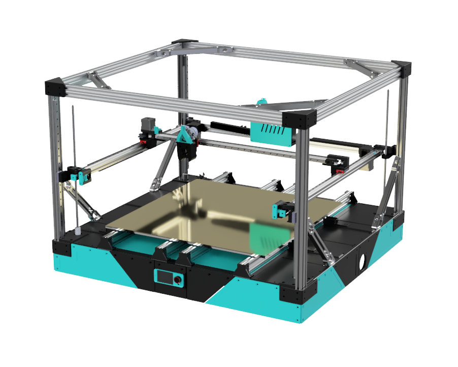

# RIFF MAX

This is a 600x600 size DIY printer that can be built without spending a fortune. 

I encourage the use of second hand parts and will not provide any complete BOM (listing specific new components/brands). 

> [!NOTE]
> Future plans for this project is to add the Bondtech Indx. It should be a good fit for this frame, for printing signs etc..

## Some key information about my original RIFF MAX build:

- Build plate 600 x 600 (assembly with 4 pcs 300x300 heat beds 
- 2020 and 2040 extrusions 
- SKR 1.4 turbo and SKR Pico controllerboards (use whatever you have that have enough drivers and can run Klipper)
- Radxa Rock 3C SBC (or a Pi. SBC with 3-4 USB ports recommended)
- MGN 12H rails/carriage on X, Y and Z. 
- Cartesian (the belts are a bit too long for corexy) 
- Klipper firmware 
- Dual Y steppermotors
- Sensorless homing on X and Y 
- Dragonburner with Sherpa micro 
- 4 x 360W 24V power supplies 

### Cutting extrusions for the frame

- 4x2040 775mm for Y (or 1075mm for the 900 version)
- 4x2040 880mm for X
- 4x2040 650mm for Z 

### Blind joints and corner plates plates:

Tap M5 holes in all 2040 Z extrusions 
Drill access holes in all extrusions to get to the button head screws  

>[!TIP]
>Check the frame for squareness and adjust/correct  as needed.
>Mount the 4 z-motor mounts with M5 10mm bolts. The motor mounts makes the frame more rigid. Check the frame again for squareness.

