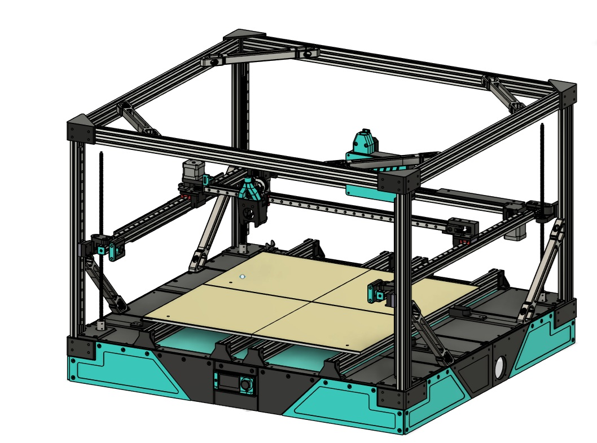

# RIFF MAX

This is a 600x600 size DIY printer that can be built without spending a fortune. 

I encourage the use of second hand parts and will not provide any complete BOM (listing specific new components/brands). 

> [!NOTE]
>I consider this to be a prototype. You have to design some custom part to match your own heat bed installation. My cover plates are specific to the heat beds I have.

## Some key information about my RIFF MAX build:

- Build plate 600 x 600 (assembly with 4 pcs 300x300 heat beds) 
- 2020 and 2040 extrusions 
- Flying gantry
- SKR 1.4 turbo and SKR Pico controller boards (use whatever you have that have enough drivers and can run Klipper)
- Radxa Rock 3C SBC (or a Pi. SBC with 3-4 USB ports recommended)
- MGN 12H rails/carriage on X, Y and Z. 
- Cartesian (the belts are a bit too long for corexy) 
- 9mm belts on Y. 6mm belt on X
- Klipper firmware 
- Dual Y steppermotors
- Dragonburner with Sherpa micro 
- 4 x 360W 24V power supplies 
- 1 x 50W 5V power supply 

### Cutting extrusions for the frame
- 4x2040 880mm for X
- 4x2040 775mm for Y 
- 4x2040 650mm for Z 
- 4x2040 850mm for the bed (change to match your heat bed) 

### Cutting extrusions for the gantry
- 1x2040 775mm for the back extrusion 
- 2x2020 755mm for Y
- 1x2020 711mm for X (meassure this one before cutting)

>[!TIP]
>Check the frame for squareness and adjust/correct  as needed.
>Mount the 4 z-motor mounts with M5 10mm bolts. The motor mounts makes the frame more rigid. Check the frame again for squareness.

